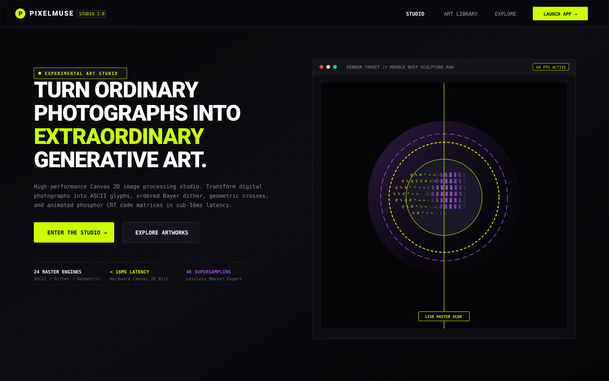
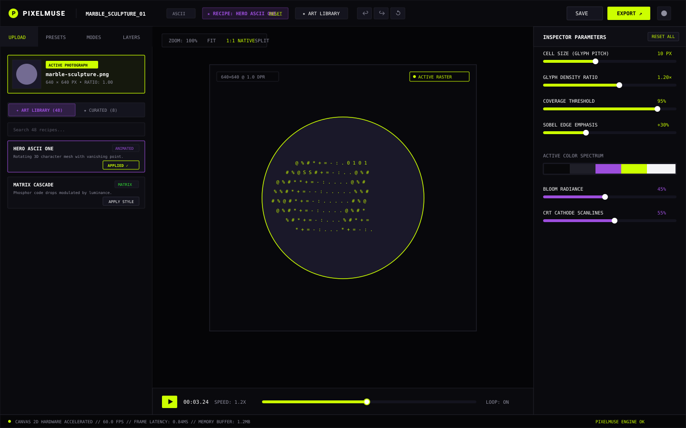
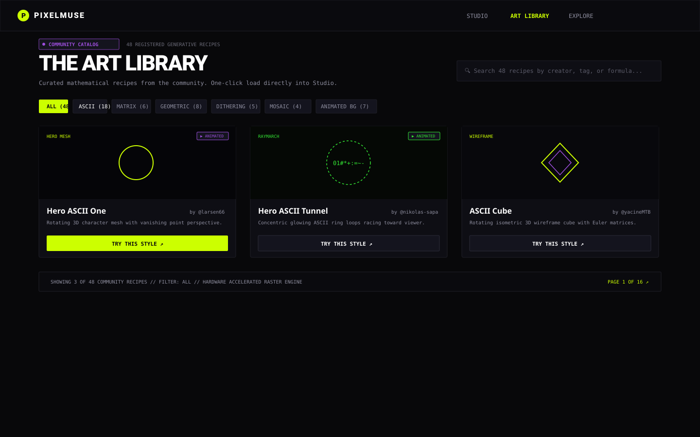

# PixelMuse — Generative Art Studio & Raster Engine

<div align="center">
  <p><strong>Turn ordinary photographs into extraordinary generative art.</strong></p>
  <p>
    An experimental dark-mode digital art studio and hardware-accelerated Canvas 2D rasterization suite.
  </p>

  [](https://www.typescriptlang.org/)
  [](https://react.dev/)
  [](https://vitejs.dev/)
  [](https://tailwindcss.com/)
  [](https://developer.mozilla.org/en-US/docs/Web/API/CanvasRenderingContext2D)
  [](LICENSE)
</div>

---

## Visual Showcase & Screenshots

### 1. Hero Landing Page
High-contrast obsidian aesthetic, editorial typography, and live generative centerpiece canvas.



---

### 2. Interactive Art Gallery (Explore Section)
Interactive generative art exhibition featuring real-time before/after laser scan sweeps and 60 FPS kinetic loops.


---

### 3. Studio Workspace & Creative Stage
Three-column professional workspace with Top Toolbar, Left Sidebar (Assets & Presets), Hardware Canvas 2D Stage, and Right Parameter Inspector.



---

### 4. Community Art Library
Comprehensive catalog of 48 generative recipes with category filters, live search, and one-click configuration loading directly into the Studio.



---

## Key Capabilities & Architecture

- **24 Hardware-Accelerated Raster Engines**:
  - **ASCII & Typographic**: Monospace luminance mapping, typography cascade dissolve, ripple displacement, and elevation bands.
  - **Dithering & Error Diffusion**: 1984 Atkinson diffusion, 8×8 Bayer ordered dither, and chromatic noise diffusion.
  - **Geometric Artifacts**: Prismatic hexagonal prisms, cruciform anchors, cross-stitch hatch, and linocut concentric rings.
  - **Kinetic Oscillators**: Animated Katakana code rain (Matrix Rain), concentric harmonic wave rings, Gray-Scott reaction-diffusion, and supersonic Schlieren shockwaves.
  - **Retro Computing & Phosphor**: CRT optical barrel distortion ($r' = r(1 + k r^2)$), scanlines, phosphor bloom, and 8-bit quantized arcade blocks.
  - **3D Perspective & Depth**: Euler rotation matrix wireframe meshes (Cube, Torus, Globe, Knot, Pyramid, Hero Mesh) and isometric voxels.
  - **Material & Shader Effects**: Sobel normal extraction and specular chrome reflection gradients.
- **Interactive Art Gallery**:
  - Live before/after laser split scanline demonstrating raw photography transforming into computed generative art.
  - Viewport-aware rendering using `IntersectionObserver` for zero CPU/GPU overhead when cards are out of view.
  - Low-resolution 280×280 preview buffers for 60 FPS responsiveness.
- **Community Art Library (48 Recipes)**:
  - Deep configuration transfer into Studio state (`renderParams`, `color`, `effects`, `motion`, `ascii`, `dither`, `mosaic`).
  - Automatic sample photo loading (`marble-sculpture`, `cyberpunk-neon`, `brutalist-facade`) when no image is uploaded.
  - Image preservation: Switching recipes immediately transforms the active user photograph without re-uploading.
  - Dedicated "Reset Defaults" action restoring original recipe parameters with full Undo/Redo history tracking.
- **Studio Creative Stage**:
  - Zoom and pan viewport (`10%` to `500%`, Fit to View, 1:1 Native).
  - Inspector sliders for cell size, density, threshold, edge emphasis, contrast, bloom, and scanlines.
  - Built-in color spectrums (Obsidian/Acid/Violet, Noir Monochrome, Signal Coral, Phosphor Green, Synthwave).
  - Full Undo/Redo history tracking (`Ctrl+Z`, `Ctrl+Y`).
  - 4K Lossless Master Export (PNG, JPEG, WebP, SVG vector trace, ASCII text dump).

---

## Quickstart & Run Commands

### 1. Prerequisites
Ensure you have **Node.js (v18.0 or higher)** installed:
```bash
node -v
npm -v
```

### 2. Clone and Install
Clone the repository and install dependencies:
```bash
git clone https://github.com/your-username/pixelmuse.git
cd pixelmuse
npm install
```

### 3. Development Server
Start the local Vite development server with Hot Module Replacement (HMR):
```bash
npm run dev
```
Open your browser at:
```text
http://localhost:5173
```

### 4. Production Build
Compile TypeScript and bundle optimized production assets:
```bash
npm run build
```

### 5. Preview Production Build
Locally preview the generated `dist/` production bundle:
```bash
npm run preview
```

---

## Automated Test Suites & Verification

PixelMuse includes comprehensive automated test suites covering all rendering engines, galleries, and workflows:

```bash
# 1. Verify all 16 broad effect families and 48 individual recipe modules
node test-generative-engine.cjs

# 2. Verify Interactive Art Gallery (before/after laser sweeps, 60 FPS loops, IntersectionObserver)
node test-interactive-gallery.cjs

# 3. Verify Art Library <-> Studio complete workflow integration and image preservation
node test-library-studio-workflow.cjs

# 4. Verify Art Library editorial catalog, search, and category filters
node test-art-library.cjs

# 5. Run strict TypeScript compiler verification (0 errors required)
npx tsc --noEmit
```

---

## Studio Keyboard Shortcuts

| Shortcut | Description |
|---|---|
| <kbd>Space</kbd> + <kbd>Drag</kbd> | Pan the canvas viewport |
| <kbd>Ctrl</kbd> + <kbd>Z</kbd> | Undo last parameter adjustment |
| <kbd>Ctrl</kbd> + <kbd>Y</kbd> / <kbd>Ctrl</kbd> + <kbd>Shift</kbd> + <kbd>Z</kbd> | Redo parameter adjustment |
| <kbd>Ctrl</kbd> + <kbd>E</kbd> | Open 4K Export Master dialog |
| <kbd>Ctrl</kbd> + <kbd>0</kbd> | Fit artwork to screen |
| <kbd>Ctrl</kbd> + <kbd>1</kbd> | Reset zoom to 100% 1:1 pixel fidelity |
| <kbd>Shift</kbd> + <kbd>?</kbd> | Toggle Keyboard Shortcuts cheat sheet |

---

## Directory Structure

```text
pixelmuse/
├── docs/
│   └── screenshots/              # High-fidelity SVG & PNG documentation screenshots
│       ├── 01-landing-hero.svg
│       ├── 02-interactive-gallery.svg
│       ├── 03-studio-workspace.svg
│       └── 04-art-library.svg
├── public/                       # Static public assets (favicons, icons)
├── src/
│   ├── components/
│   │   ├── common/               # Brand logo, Navigation rail, Status footer
│   │   ├── home/                 # Hero section, Interactive ExploreGallery, Workflow
│   │   ├── library/              # Art Library cards, inspection modal, preview canvas
│   │   ├── studio/               # TopToolbar, LeftSidebar, CanvasStage, InspectorPanel
│   │   └── ui/                   # Button, Badge, Slider, Select, ColorPicker
│   ├── hooks/                    # useCanvasRenderer, useImageDrop, useKeyboardShortcuts
│   ├── layouts/                  # StudioLayout, RootLayout
│   ├── pages/                    # HomePage, StudioPage, ArtLibraryPage, ExplorePage
│   ├── presets/                  # Curated art presets (Digital Bloom, Cyber Terminal, etc.)
│   ├── recipes/                  # Central community recipe registry (48 recipes)
│   ├── rendering-engine/         # CanvasPipeline, ColorProcessing, EdgeDetection
│   ├── rendering-modes/          # 16 independent raster and shader rendering modules
│   ├── stores/                   # studioStore, libraryStore, exploreStore, authStore
│   ├── types/                    # Engine, studio, preset, and recipe TypeScript definitions
│   └── utilities/                # Math, colors, sample photography generators
├── test-generative-engine.cjs    # Automated Engine verification suite (98 checks)
├── test-interactive-gallery.cjs  # Automated Gallery verification suite (21 checks)
├── test-library-studio-workflow.cjs # Automated Workflow verification suite (16 checks)
├── test-art-library.cjs          # Automated Library verification suite (45 checks)
├── package.json
├── tsconfig.json
└── vite.config.ts
```

---

## License

MIT License © 2026 PixelMuse Studio. Built for digital artists, creative technologists, and generative design explorers.
